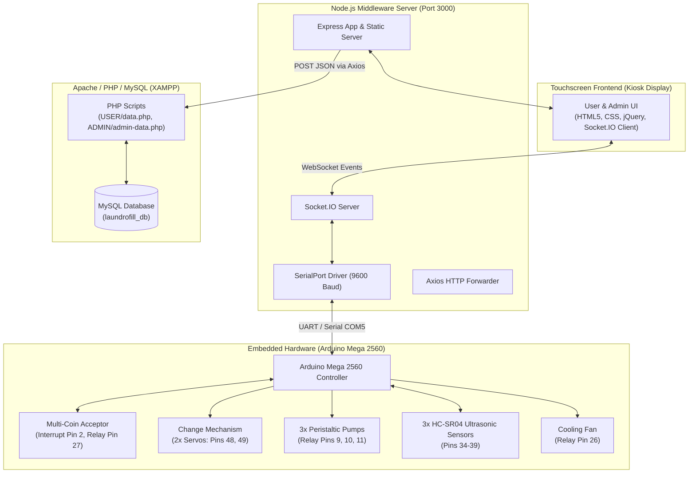
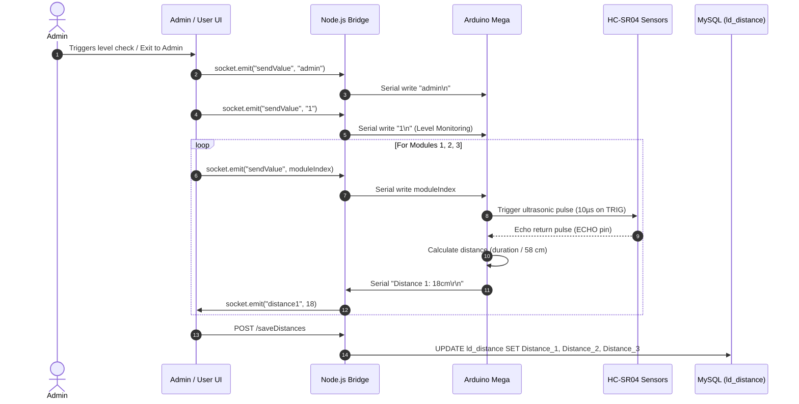

# LaundroFill — System Architecture & Technical Documentation

This document describes the current architecture, data flows, hardware integrations, and sequence workflows for the **LaundroFill** liquid detergent dispensing machine kiosk.

---

## 1. System Overview

**LaundroFill** is an IoT-enabled smart liquid detergent dispensing and refilling machine kiosk designed for laundromats and self-service laundry facilities. 

The system features:
- **Normal Refill Mode**: Pre-set volume dispensing (100ml, 250ml, 500ml, 1000ml) into customer-provided bottles.
- **Smart Dispense Mode**: Recommended detergent dosage (60ml, 120ml, 180ml) based on laundry weight (1–8 kg), fabric type (Cotton, Polyester, Blend), and stain severity (Low, Medium, High).
- **Physical Hardware Control**: Microcontroller-driven peristaltic pumps, pulse coin acceptor, change dispensing servos, and ultrasonic liquid reservoir sensors.
- **Operator Administration**: Dashboard for product catalog and pricing, sales analytics, inventory tracking, and reservoir level monitoring.

---

## 2. High-Level Architecture Diagram



---

## 3. Subsystem Breakdown

### 3.1 Embedded Layer (`LAUNDRO_FILL/LAUNDRO_FILL.ino`)
- **Microcontroller**: Arduino Mega 2560 communicating over UART at 9600 baud.
- **Peristaltic Pumps**:
  - Controlled by active-low relays on digital pins 11 (Tide), 10 (Breeze), and 9 (Ariel).
  - Timing is volume-dependent:
    - 60ml: 5,160 ms
    - 120ml: 10,260 ms
    - 180ml: 15,420 ms
    - 240ml: 20,580 ms
    - 100ml: 8,575 ms
    - 250ml: 21,437 ms
    - 500ml: 42,875 ms
    - 1000ml: 85,750 ms
- **Coin Acceptor**:
  - Pulse output wired to digital pin 2 with external interrupt `RISING` (`coinPulseISR`).
  - Gated by relay on pin 27 (active-low enable).
- **Coin Change Mechanism**:
  - Two servo motors drop coins from dedicated change tubes:
    - Servo 1 (Pin 48): Dispenses ₱1 coins (`change % 5`).
    - Servo 2 (Pin 49): Dispenses ₱5 coins (`change / 5`).
- **Ultrasonic Level Sensors**:
  - HC-SR04 sensors on reservoir tanks:
    - Module 1: Trig 34, Echo 35
    - Module 2: Trig 36, Echo 37
    - Module 3: Trig 38, Echo 39
  - Thresholds: 21–25 cm triggers Low Volume Warning; 26–30 cm triggers Empty Tank Warning.

### 3.2 Middleware Layer (`app.js`)
- **Runtime**: Node.js, Express, Socket.IO, `@serialport/parser-readline`.
- **Serial Interface**: Connects to `COM5` (9600 baud).
- **Socket.IO Events**:
  - `coinInserted`: Broadcasts coin pulse count to client.
  - `distance1`, `distance2`, `distance3`: Broadcasts reservoir liquid distance.
  - `sendValue`: Relays commands from client to Arduino serial stream.
- **HTTP Routing**:
  - Serves static assets from `USER/`.
  - Proxies `POST /saveTransaction` and `POST /saveDistances` to `http://localhost/display-laudrofill/USER/data.php`.

### 3.3 Frontend Layer (`USER/` and `ADMIN/`)
- Single-page interface managing view visibility via class toggling (`hidden`).
- **USER Kiosk UI**: Step-by-step wizard for customer selections, payment feedback, dispensing progress, and transaction completion.
- **ADMIN UI**: Protected dashboard for product pricing, transaction logs, sales summaries, inventory tracking, and reservoir diagnostics.

### 3.4 Database Layer (`MySQL - laundrofill_db`)
- `transactions`: Stores completed dispenses (`TranID`, `TranDate`, `ProductName`, `Service`, `LaundryLoad`, `FabricType`, `StainLevel`, `Volume`, `Amount`).
- `users`: User and administrator authentication credentials (`UserID`, `Username`, `Password`, `UserType`).
- `products`: Product catalog, default volumes, and unit pricing (`ProductID`, `ProductType`, `ProductName`, `ProductDesc`, `Volume1..3`, `UnitPrice1..3`).
- `ld_distance`: Real-time tank liquid distance sensor records (`Distance_1`, `Distance_2`, `Distance_3`).

---

## 4. Workflows & Sequence Diagrams

### 4.1 Dispense & Payment Flow

```mermaid
sequenceDiagram
    autonumber
    actor Customer
    participant UI as Kiosk Web UI (USER)
    participant Node as Node.js Bridge (app.js)
    participant Arduino as Arduino Mega 2560
    participant HW as Hardware (Relays / Servos)
    participant DB as PHP / MySQL Backend

    Customer->>UI: Tap screen to begin
    UI->>Node: socket.emit("sendValue", "L")
    Node->>Arduino: Serial write "L\n"
    Arduino->>HW: Turn on cooling fan (Pin 26)

    Customer->>UI: Selects "Smart Dispense"
    UI->>Node: socket.emit("sendValue", "2")
    Node->>Arduino: Serial write "2\n"

    Customer->>UI: Inputs Load (e.g. 5kg), Fabric, Stain Level
    UI->>UI: Run smartVolumeSuggest() (e.g. 120ml)
    UI->>Node: socket.emit("sendValue", parameters)
    Node->>Arduino: Serial write parameters

    Customer->>UI: Confirms Volume & Selects Brand (e.g. Tide)
    UI->>Node: socket.emit("sendValue", productID)
    Node->>Arduino: Serial write productID
    Arduino->>HW: Turn on Coin Slot (Pin 27 LOW)

    Customer->>HW: Inserts Coins into Acceptor
    HW->>Arduino: Pulse train on Pin 2 Interrupt (coinPulseISR)
    Arduino->>Node: Serial "Coins Inserted: 10\r\n"
    Node->>UI: socket.emit("coinInserted", 10)
    UI->>UI: Update live paid amount; enable "Dispense" button

    Customer->>UI: Clicks "Dispense"
    UI->>Node: socket.emit("sendValue", "d")
    Node->>Arduino: Serial write "d\n"
    Arduino->>HW: Turn off Coin Slot (Pin 27 HIGH)

    alt Change Required (Paid > Cost)
        Arduino->>HW: Trigger Servo 1 (₱1) and/or Servo 2 (₱5)
    end

    Arduino->>HW: Activate Pump Relay (Pin 10 LOW for delayTime)
    HW-->>Customer: Dispense liquid detergent into container
    Arduino->>HW: Deactivate Pump Relay (Pin 10 HIGH)
    Arduino->>Node: Serial "Dispensing Complete!\r\n"

    UI->>Node: POST /saveTransaction (JSON)
    Node->>DB: Forward POST to data.php
    DB->>DB: INSERT into transactions table
    UI->>UI: Show completion screen and reset
```

---

### 4.2 Liquid Level Monitoring Flow



---

## 5. Hardware Pinout Reference

| Component | Arduino Mega Pin | Type | Details |
| :--- | :--- | :--- | :--- |
| **Pump 1 (Tide)** | `Pin 11` | Digital Output | Active LOW relay |
| **Pump 2 (Breeze)** | `Pin 10` | Digital Output | Active LOW relay |
| **Pump 3 (Ariel)** | `Pin 9` | Digital Output | Active LOW relay |
| **Cooling Fan** | `Pin 26` | Digital Output | Active LOW relay |
| **Coin Acceptor Power** | `Pin 27` | Digital Output | Active LOW relay (LOW = ON, HIGH = OFF) |
| **Coin Signal Pulse** | `Pin 2` | Interrupt Input | `INPUT_PULLUP`, `RISING` edge interrupt |
| **Servo 1 (₱1 Change)**| `Pin 48` | PWM Servo | $70^\circ$ (idle) $\leftrightarrow$ $140^\circ$ (dispense) |
| **Servo 2 (₱5 Change)**| `Pin 49` | PWM Servo | $130^\circ$ (idle) $\leftrightarrow$ $70^\circ$ (dispense) |
| **Sensor 1 (TRIG / ECHO)** | `Pin 34` / `Pin 35` | Digital I/O | Ultrasonic distance measurement (Tank 1) |
| **Sensor 2 (TRIG / ECHO)** | `Pin 36` / `Pin 37` | Digital I/O | Ultrasonic distance measurement (Tank 2) |
| **Sensor 3 (TRIG / ECHO)** | `Pin 38` / `Pin 39` | Digital I/O | Ultrasonic distance measurement (Tank 3) |
