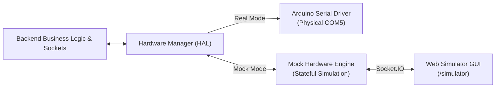
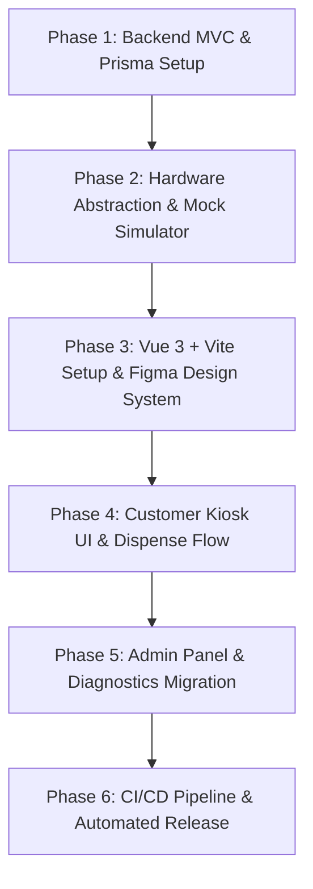

# LaundroFill — Refactoring & Migration Plan

This document outlines the architectural roadmap and phased strategy for modernizing the **LaundroFill** codebase. It migrates the legacy dual-tier stack (jQuery, PHP/Apache proxy, and ad-hoc scripts) into a unified, modular **MVC backend** and a high-performance **Vue 3 + Vite** touchscreen frontend, accompanied by an interactive **Hardware Mock Simulator** and **CI/CD pipeline**.

---

## 1. Locked-in Architecture Decisions

| Component | Target Technology | Rationale |
| :--- | :--- | :--- |
| **Frontend** | **Vue 3 + Vite + Tailwind CSS / Pinia** | Lightweight, responsive single-page kiosk interface, seamless component modularity matching the Figma prototype. |
| **Backend** | **Node.js + Express (MVC Architecture)** | Consolidates API routing, database transactions, and hardware communication into one server. Eliminates PHP/Apache dependency. |
| **Database & ORM** | **MySQL + Prisma ORM** | Type-safe schema migrations, queries, and direct compatibility with existing MySQL transaction data. |
| **Real-Time Layer** | **Socket.IO** | Bi-directional communication between client, backend, and hardware controller. |
| **Hardware Simulation** | **Interactive Web GUI Simulator** | Web-based hardware dashboard allowing testing of coin insertions, reservoir tank levels, and pump activations without physical hardware. |
| **Git & Versioning** | **Conventional Commits & Branches** | Standardized commits (`feat:`, `fix:`, `refactor:`, `chore:`, etc.) and structured branches (`feature/*`, `fix/*`). |
| **CI/CD** | **GitHub Actions** | Automated linting, test suites, multi-platform builds, and release packaging. |

---

## 2. Target MVC Directory Structure

```text
display-laundrofill/
├── .github/
│   └── workflows/
│       ├── ci.yml                 # Linting, typecheck, unit tests
│       └── release.yml            # Automated semantic release & bundling
├── backend/                       # Node.js + Express MVC Backend
│   ├── src/
│   │   ├── config/                # Environment variables, database connection, serial ports
│   │   ├── controllers/           # HTTP Request Handlers (Transaction, Product, Auth, Admin)
│   │   ├── models/                # Prisma ORM schemas and database access abstractions
│   │   ├── services/              # Business logic (Smart Dispense calculation, sales analytics)
│   │   ├── hardware/              # Hardware Abstraction Layer (HAL)
│   │   │   ├── ArduinoSerial.js   # Physical UART/Serial driver (COM / /dev/ttyACM)
│   │   │   ├── MockHardware.js    # In-memory hardware simulation engine
│   │   │   └── HardwareManager.js # Unified interface switching between Physical / Mock
│   │   ├── sockets/               # Socket.IO event handlers and emission gateways
│   │   ├── middlewares/           # Auth, error handling, payload validation
│   │   └── server.js              # Application entry point
│   ├── prisma/
│   │   └── schema.prisma          # Database schema definition & migrations
│   └── package.json
├── frontend/                      # Vue 3 + Vite Touchscreen UI
│   ├── src/
│   │   ├── assets/                # Logos, icons, branding matching Figma
│   │   ├── components/            # Reusable UI widgets (Keypads, Modals, Tank gauges, Cards)
│   │   ├── layouts/               # Kiosk Layout, Admin Layout
│   │   ├── views/
│   │   │   ├── kiosk/             # Customer flow (Splash, ServiceType, SmartDispense, Refill, Payment, Dispensing)
│   │   │   ├── admin/             # Admin flow (Login, Products, SalesReports, TankMonitoring)
│   │   │   └── simulator/         # Interactive Hardware Simulator Dashboard
│   │   ├── stores/                # Pinia state stores (kioskStore, hardwareStore, adminStore)
│   │   ├── services/              # Axios API clients & Socket.IO client singleton
│   │   ├── App.vue
│   │   └── main.js
│   ├── vite.config.js
│   └── package.json
├── ARCHITECTURE.md                # System diagrams & hardware specifications
├── REFACTORING_PLAN.md            # This roadmap document
└── README.md                      # Project documentation
```

---

## 3. Hardware Abstraction Layer & Interactive Mock Simulator

Because the physical LaundroFill machine is disassembled, all hardware interactions will route through a **Hardware Abstraction Layer (HAL)**:



### Mock Simulator Capabilities
- **Coin Acceptor**: Interactive buttons for inserting ₱1, ₱5, ₱10 coins; simulates debounce pulse trains sent over interrupt pin 2.
- **Change Hopper Servos**: Real-time animation showing ₱1 and ₱5 coins dispensed based on remaining change balance.
- **Ultrasonic Sensors**: Interactive sliders to adjust liquid tank levels (0–35 cm), triggering "Low Volume" and "Empty" alerts.
- **Peristaltic Pumps**: Visual active indicators with live timers counting down dispensing durations based on selected milliliter volume.
- **Cooling Fan**: Power state status LED indicator.

---

## 4. Git Standards & Workflow

### 4.1 Branching Strategy
- `main`: Production-ready code; tagged releases only.
- `develop`: Integration branch for finished features.
- `feature/<ticket-or-name>`: Scoped feature development (e.g., `feature/vue-kiosk-ui`, `feature/mock-hardware-simulator`).
- `fix/<issue-name>`: Bug fixes.
- `refactor/<scope>`: Code refactoring without behavior modification.

### 4.2 Conventional Commits
All commits must follow the [Conventional Commits](https://www.conventionalcommits.org/) specification:
- `feat(kiosk): implement smart dispense volume calculation screen`
- `fix(serial): prevent buffer overflow on rapid coin pulses`
- `refactor(backend): migrate PHP transaction endpoint to Express controller`
- `chore(ci): add GitHub Actions release workflow`
- `docs(readme): update setup and simulator guide`

---

## 5. Phased Implementation Roadmap



### Phase 1: Backend MVC & Prisma Foundation
- Initialize Node.js backend workspace with Express.
- Setup Prisma ORM connected to MySQL, modeling `Transaction`, `User`, `Product`, and `TankDistance` entities.
- Implement REST controllers and service layers for Transactions, Products, and Admin auth.
- Integrate Socket.IO server for event-driven hardware communication.

### Phase 2: Hardware Abstraction Layer & Interactive Mock Simulator
- Build `HardwareManager` interface supporting dual modes (`REAL` and `MOCK`).
- Implement the stateful `MockHardware` engine replicating Arduino Mega behavior.
- Build the `/simulator` web dashboard with interactive controls (coin buttons, liquid sliders, pump status LEDs).

### Phase 3: Vue 3 Frontend & Figma Design System
- Scaffold Vue 3 + Vite project with Tailwind CSS and Pinia.
- Build design tokens, typography (`Kumbh Sans`), colors, and custom components replicating the Figma wireframe.
- Set up Socket.IO and Axios integration singletons.

### Phase 4: Kiosk Customer Flow Migration
- Implement Splash screen with kiosk auto-reset and sound effects.
- Implement Service Selection: "Normal Refill" vs. "Smart Dispense".
- Implement Smart Dispense wizard: Laundry Load (1–8 kg slider/stepper), Fabric selection, Stain severity, and volume recommendation.
- Implement Coin Payment screen with live coin counter and change calculation.
- Implement Dispensing Progress screen with synchronized pump animation and completion buzzer.

### Phase 5: Admin Panel & Reporting Migration
- Implement authenticated Admin dashboard.
- Build Product Catalog & Price Editor with live updates.
- Build Sales History and Transaction Reporting with date-range filters and CSV export.
- Build Tank Level Monitoring view visualizing real-time ultrasonic sensor heights.

### Phase 6: CI/CD Pipeline & Packaging
- Setup GitHub Actions workflow for PR checks (ESLint, Prettier, Prisma validation, unit tests).
- Setup automated semantic release pipeline generating distribution bundles.
- Document deployment guide for kiosk mode (Chromium kiosk flags on Linux/Windows).
